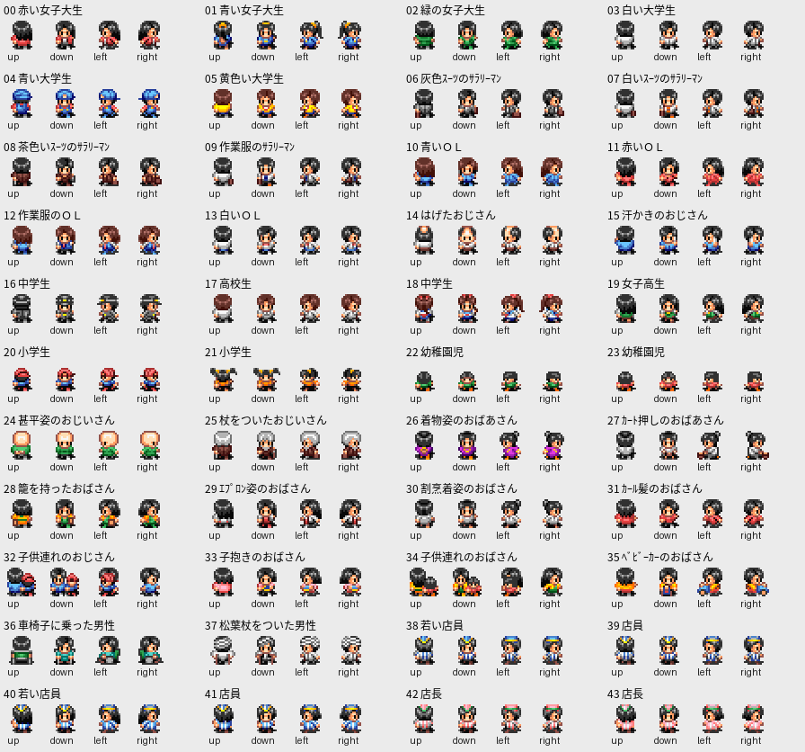

# 顧客データ解析：建物・客構成・購買型・外見の接続

2026-11-13。ユーザー提供ディスクと、その中の原EXEからデータを静的に展開した。営業の更新・原CPUの実行は行っていない。

## 今回解いた対応関係

| 層 | 原位置と構造 | 内容 |
|---|---|---|
| 建物定義 | `8009DA10`、56バイト×69件 | 通常・用地など59件と、「拡張00〜09」という名前の10件。建物の大きさ・画像範囲・客構成の候補5枠を保持する。69種類の通常建物があるとは呼ばない。 |
| 客構成 | `8009FF1C`、20バイト×137件 | 1件につき「購買プロファイル番号・人数」5組。人口用人数と、有効な購買プロファイルに結び付く人数を分離した。 |
| 購買プロファイル | `800A09D0`、24バイト×144件 | 外見グループ、開始時間、滞在時間、予算、主商品・追加商品、来店手段、10項目の係数を展開した。 |
| 外見説明 | `800A1750`、23バイト×44件 | 先頭21バイトにShift-JISの外見名があり、末尾2バイトに性別・年齢を思わせる値がある。後者の意味は推定に留める。 |
| 外見選択 | `800A1B44`、4バイト×44件 | 購買グループから抽選する外見ID4枠。重複枠を消さず、元の重みを維持した。 |
| 方向画像 | `MAN0.TIM`、256×176画素 | 客38外見・店員6外見の4方向、計176セルとの対応を記録した。 |

主な成果は、これらを番号だけの別々の表ではなく、**建物→客構成→購買型→外見→元画像**として結び付けたことである。`customer-data.json` に全件を、`shopping-profiles.csv` に144件の閲覧用一覧を保存した。

購買型・客構成・外見選択の数と基本的な式は、既に解析済みだった。今回は23バイトの外見説明表を展開し、全表の参照を連結し、範囲外参照の意味を原コードまで追った。既存件数を新発見として数え直していない。

## 電気屋の客構成136：人口と購買候補を同じ表へ潰さない

構成136の原データは次のとおりである。

| 購買プロファイル番号 | 人数 | 状態 |
|---:|---:|---|
| 132 | 2 | 有効 |
| 133 | 2 | 有効 |
| 112 | 2 | 有効 |
| 144 | 1 | 144件の表の範囲外 |
| -1 | 0 | 空き枠 |

有効な番号は0〜143である。144番を原位置の式で読むと、次の表の「赤い女子大生」の文字列を購買データとして解釈してしまう。従って、隠された145人目の購買型が存在するという意味ではない。

この範囲外参照は、以前のAndroid用抽出コードでも除外していた。今回、次の原コード上の扱いを解明した。

- 通常のフィルター経路（`800CDA00 == 0`）では、構成から読んだ番号で主商品バイトを取得する。144番の場合、この値は符号付きで`-111`になる。
- 商品判定`80027328`は、商品番号が負または27以上なら2を返す。呼出元`80026688..80026694`は、この戻り値で割当てを飛ばす。
- 人口集計`80020498`は、購買型が有効かを見ず、番号が`-1`でない組の人数を足す。構成136は人口7人、有効な購買型の人数6人となる。

したがって、移植時に無効な組を元データから完全に削除すると、購買候補の除外だけでなく人口まで変わってしまう。`android-customer-bridge.json` では人口用の人数配列を別に保持した。

| 元マップ | 原人口集計と同じ合計 | 無効な組を削除した場合 | 差 |
|---|---:|---:|---:|
| TOWN0001 | 2,179 | 2,177 | 2 |
| TOWN0002 | 1,880 | 1,879 | 1 |
| TOWN0003 | 1,424 | 1,424 | 0 |
| TOWNPS | 2,839 | 2,838 | 1 |

構成136を持つセルは、TOWN0001の`(39,10)`・`(15,14)`、TOWN0002の`(39,26)`、TOWNPSの`(52,22)`。すべて電気屋の画像番号519に対応する。座標は0始まりである。

フィルターを飛ばす`800CDA00 != 0`の経路について、今回ゲームでの到達可能性は調べていない。通常営業でのメモリー破壊が発生するといった主張はしていない。原コードの読取り根拠は `customer-readers.asm` と `profile144-analysis.json` に保存した。

## 外見名と176セル

外見説明表から「赤い女子大生」「作業服のサラリーマン」「カート押しのおばあさん」など44件の名前を得た。23バイトごとの境界は、21バイトの文字列領域と末尾2バイトに分かれ、44件の直後に外見選択表が始まる。

末尾の0/1と4〜75の値はラベルとの対応から性別・参考年齢と推定できるが、この23バイト表の元読出し箇所は特定できていない。実際のNPC年齢とみなしてアプリへ適用しない。初期店員の実年齢は、別のTOWN内レコードの年齢バイトとして区別した。

- 購買型から選ばれる外見IDは0〜37。
- 店員3配属枠の男女用外見表には38〜43が入る。
- 方向の画像オフセットは、上・下・左・右に対して`[1,0,2,3]`。
- 元画像コードは`640 + 外見ID×4 + 方向オフセット`。これらの表から使うコード640〜815は、すべてMAN0.TIMの実画素範囲に収まる。
- 176セル中、画素インデックスが完全一致する組は画像669と677の1組で、異なる画素列は175種だった。

描画コードの受理範囲に含まれる816〜819についても、この客選択表・店員外見表・4マップ計140人分の初期店員からは生成されない。実ファイルにない4セルを補って架空の外見を追加する根拠はない。他の全コード経路が到達不能であるとまでは断定していない。



`person-texture-map.json` に全176セルのUV・インデックスハッシュ・元16bit色列ハッシュを保持する。PNGは閲覧用であり、GPUの半透明合成・画面表示時間を再現したものではない。

## ファイルと再現

- `customer-data.json`：全表、各項目の元アドレス、原バイト、参照関係。
- `android-customer-bridge.json`：移植用の小さな固定JSON。人口配列、外見名、抽選4枠、方向オフセット、配属用外見を収録。推定の性別・年齢項目は含めていない。
- `shopping-profiles.csv`：144購買型の閲覧・比較用。
- `person-texture-map.json`：外見・方向・画像の対応と、初期店員140レコードの外見・実年齢。
- `source/`：5つの原テーブル区間と、元MAN0.TIM。原EXE全体やRAMは重複保存していない。

```sh
python -m pip install -r requirements.txt
python extract-customer-data.py /absolute/path/SLPS_00782.BIN
```

前回の`../20261113-disc-data-extraction/disc-inventory.json`とTIMデコーダーを再利用する。入力ディスクSHA-256は`8d8eda789c5a2fe892a4722719b0466dd7d126eed6cd99ad05a807d81b57d1c1`、原EXEは`d6a167a1c9e0fe98d7e44e12968caa489ac3eb7ed3b9e46012a188af8432b1fd`。必要ファイルは毎回、元ディスクのLBAから読み、前回の索引のハッシュとも照合する。

## 状態

顧客関係の移植用データと、人口・有効購買型を分離する仕様まで整理できた。今回はデータ解析の更新であり、スマホ版のコード・APKは更新していない。未確認のメタデータの用途を、通常プレイ再現より優先して追い続けない。
