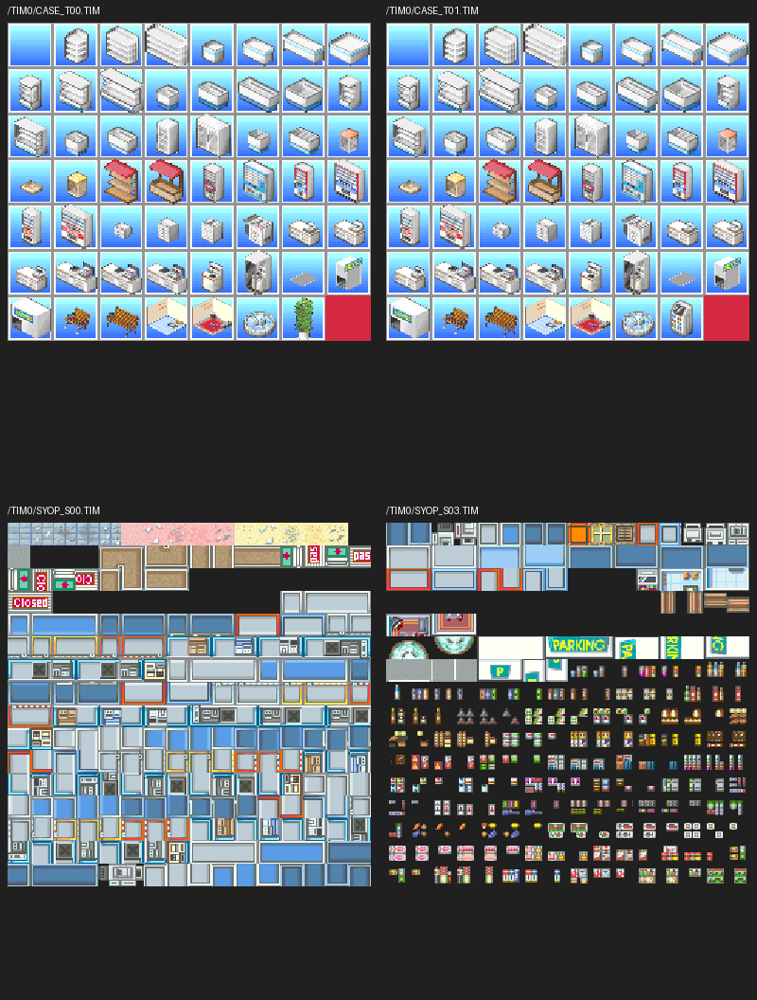

# ディスク本体のデータ解析：画像・外部配置・リソース索引

2026-11-13。ユーザー指示に従い、営業更新の継続検証から、ディスク内データの構造解析へ作業の中心を戻した。この作業では原CPUを実行していない。

## 新しく判明した内容

| 対象 | 解析結果 |
|---|---|
| `/DAT/SHOP0302.BIN` | 3,106バイト。什器グリッドはオフセット194から。EXE内の配置は196からで、間に2バイトの配置用パディングがある。外部ファイルの194番位置へゼロ2バイトを挿入すると、EXE内の16番レイアウト全3,108バイトと一致する。 |
| 外部配置の中身 | 24×24の半マス座標。原点フラグ付きレコード67件のうち、壁36件・什器31件。床、全セル、回転、下段の在庫データ、末尾224バイトをJSONへ展開した。 |
| TIMの索引 | ディスクには34画像。EXEのファイル名ポインター列にも34件あるが、独立したVRAM転送矩形の2つのバンクは各32件。最後の2画像には対応する独立矩形がない。 |
| `CASE_T01.TIM` | `CASE_T00.TIM`とパレットは同一。違いは397画素インデックス、32×32アイコンの54番枠だけ。什器定義の45番がこのアイコン番号を参照する。差分範囲はX=200..215、Y=193..222。 |
| `SYOP_S03.TIM` | パレットは`SYOP_S00.TIM`と同一だが、画素インデックス61,528個が異なる。別配置の什器・商品シートとして抽出した。使用場面は未確定。 |
| 外部配置のパス | EXEには`DAT1`/`DAT2`の配置ファイル名24件があるが、その24パスはディスクに存在しない。`SHOP0302.BIN`は`DAT1`ではなく`DAT`に存在する。同名を理由にパスが一致したとは扱わない。 |
| `/3MIN.BIN` | ファイルの全31,455,687バイトがゼロ。動画・画像として解読すべきペイロードは入っていない。 |

配置ファイルのオフセット196をそのまま使うと、原点フラグを持つ36レコードのうち35件が什器の範囲外になる。194で読むと全67件が定義範囲へ入り、配置全体も既存の16番と一致した。外部ファイルを新しい31件目の配置として増やす必要はない。

## 抽出物

- `disc-inventory.json`：ISO9660の77ファイル、LBA、バイト数、セクター形式、内容SHA-256。XAは2,048バイトへのISO投影と音声ペイロードを区別している。
- `tim-catalog.json`：全34TIMの寸法、画素オフセット、色数、元の16bitパレット全語、画素・パレットのハッシュ。
- `source/CASE_T01.TIM`、`source/SYOP_S03.TIM`：今回の追加抽出画像の元バイト。PNGとSTPビット画像も添付。
- `external-layout.json`、`source/SHOP0302.BIN`：配置構造と元ファイル。未知のヘッダー値と未使用範囲は名前を推測せず保持する。
- `resource-tables.json`、`resource-reader.asm`：EXEの画像34件・外部配置24件の参照表と、原ファイル読込／矩形参照の静的逆アセンブル。
- `fixture-icon-map.json`：53什器のアイコン参照番号と、追加画像の差分との対応。
- `alternate-textures-preview.png`：元画像2組の比較。上段はCASE_T00/T01、下段はSYOP_S00/S03。



## 再現

```sh
python -m pip install -r requirements.txt
python extract-disc-data.py /absolute/path/SLPS_00782.BIN
python analyze-resource-tables.py /absolute/path/extracted/SLPS_007.82
```

入力ディスクはユーザー提供のMODE2/2352イメージ。SHA-256は `8d8eda789c5a2fe892a4722719b0466dd7d126eed6cd99ad05a807d81b57d1c1`。原EXEは `d6a167a1c9e0fe98d7e44e12968caa489ac3eb7ed3b9e46012a188af8432b1fd`。EXE内の配置表は`0x800A2074`、1件3,108バイト。什器定義は`0x80099F0C`、1件196バイト。画像名表は`0x8009863C`、矩形表は`0x800983D0`と`0x800984D0`。

## 未確定事項とスマホ版への引継ぎ

画像2点の全使用場面・未使用判定は未確定である。ファイル名があることや、独立した転送矩形がないことだけで、全コード経路で使用されないとは断定しない。PNGは閲覧用であり、PS1の半透明合成は再現していない。元の16bit色とSTPビットは保持した。

今回の77ファイル走査は、全ゲーム仕様の解析完了を意味しない。画像34件と外部配置1件の構造を展開し、元データとの対応を確定した範囲である。音声の130素材・BGM・通常の30配置など、既存の抽出結果は今回の新発見へ水増ししない。

スマホ版への実装・APKはこの作業では更新していない。今後も通常プレイの再現に必要な未解読データを優先し、必要範囲の解析後に実装へ反映してAndroid APKをビルドする。営業の更新数増加を主作業へ戻さない。
