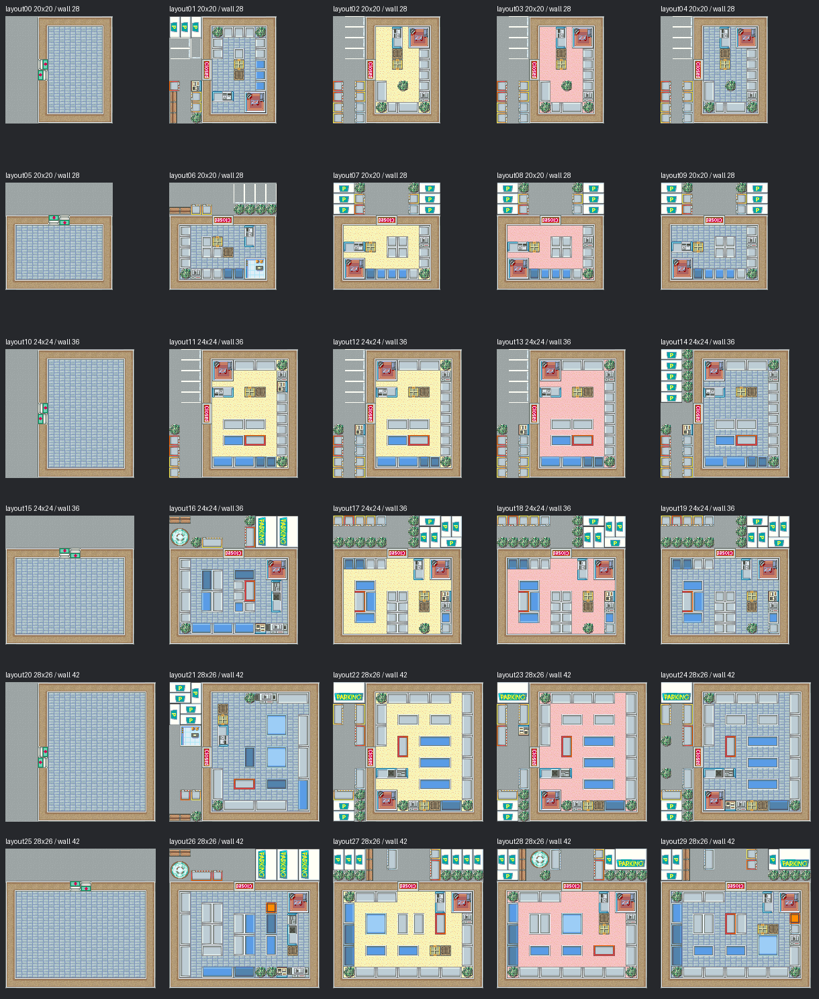
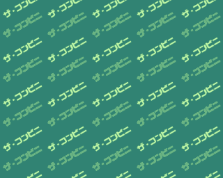

# 店内の床・壁・30配置とKABEE背景の原画素対応

2026-11-17 JST。［確実］内蔵30配置の壁アンカー1,060か所を床画像コードへ接続し、床・什器だけの参照画像を作成した。別途KABEE.CEL/BGDの16部品・320セルをKYOU.TIMの原画素へ接続した。**床の基本規則や30配置の存在自体は既知である。今回の追加は原画像と実際の使用位置の対応付けであり、完成したゲーム画面の検証ではない。**

## 今回分かった対応

| 対象 | 原データとの接続 |
|---|---|
| 内蔵30配置の床 | 有効な4,260セルを元画像へ接続。床材・周辺タイルの既存定義を再利用 |
| 壁アンカー | 種別53の1,060か所すべてで、低位の画像コード20～27と同じ位置の床コードが一致 |
| 什器の表示セル | 1,366か所を前回の原画像切出し表へ接続。全て元画素の範囲内 |
| KABEE.CEL | 宣言16枠をKYOU.TIMの16×16画素へ接続。物理20枠の末尾4枠はゼロ |
| KABEE.BGD | 宣言20×16＝320セルを16部品へ接続。ファイル末尾の320セル分はゼロ |
| 原CPU・営業更新 | いずれも0回。原データ・参照位置・範囲の静的照合のみ |

床36画像・床材0/5/10、初期30配置の床集計は[既存の床解析](../20261113-floor-cleaning-data/README.md)で判明している。種別53が壁であることも、以前の配置解析で使っていた識別である。什器の切出しは[前回の画像対応](../20261117-interior-source-crops-data/README.md)を再利用し、新しい画像解読として二重計上しない。

## 壁は什器53番の画像ではない

配置内のアンカーはグリッドワードのbit31、種別は`(word>>12)&1023`、低位画像コードは`word&1023`。原描画0x8005643Cは什器の低位コード60～359を描くため、20～27の壁アンカーはこの什器描画経路には入らない。

一方、原床描画0x800561CCは、床配列のコード36未満を16×16で表示する。30配置を結合すると、壁の全1,060アンカーについて次が成立した。

```text
アンカーの半マス座標(x,y)は両方とも偶数
床位置 = (x/2, y/2)
グリッドの低位画像コード = その位置の床コード = 20～27
```

したがって、この30配置の壁の見た目は床側の画像に接続する。存在しない「什器定義53」の画像を読み足す必要はない。これは元配置での一致であり、任意の破損データや全ての改装操作後にも自動同期することを証明したものではない。

| 壁画像コード | 対応する壁アンカー数 |
|---:|---:|
| 20 | 30 |
| 21 | 30 |
| 22 | 30 |
| 23 | 30 |
| 24 | 215 |
| 25 | 245 |
| 26 | 225 |
| 27 | 255 |

[全壁アンカー・床配列・什器位置](layout-floor-wall-map.json)には各配置の座標を保持した。位置は半マス、床画像は1マス＝16画素、什器画像のアンカー間隔は半マス＝8画素と区別する。[床36画像の元画素対応](floor-source-crops.json)には原色ワードとパレットのハッシュを記録した。

## 30配置の参照画像



原EXEの0x800A2074から1件3,108バイト×30件を読む。床は+12・行間隔14バイト、グリッドは+196・行間隔112バイト。グリッド描画では低位コード0および`word&0xC00`を除外し、60～359の什器本体だけを重ねた。

商品在庫の初期化、補充による商品画像の配置、客・店員、経路、UI、照明、原GPUの最終合成は含めていない。これは原テンプレートの床・壁・什器の位置を確認する資料画像であり、原処理から出店を実行した画面やAndroid実装のスクリーンショットではない。

PNGの透明色は原色ワード0を使う。STPによる半透明混合の代用にはせず、元のインデックス・BGR555/STPワード・パレットのハッシュを別に保持している。

## KABEEという名前を店内壁材と混同しない

KABEE.CELの16部品は、KYOU.TIMの元画像矩形`(0,72,64,64)`を4×4に分けた16×16画像だった。CLUTワード0x7B00は原転送先(0,492)、TPAGE0x87は8bitの画素ページへ対応する。元KYOUは256×240であり、参照する最終行135まで全て実画素内にある。転送要求の256行に合わせた不足行の生成は不要である。

KABEE.BGDは次の構造を持つ。

| 範囲 | 内容 |
|---|---|
| +0～3 | 原マジック0xC0000023 |
| +4～7 | 列20・行16・部品幅16・部品高さ16 |
| +8～647 | 有効な320個のu16部品番号。0～15を各20回参照 |
| +648～1287 | ゼロ640バイト。追加の表示320セルとして扱わない |

構成する元画像は320×256である。原背景初期化の種別1の表示枠は320×240だが、後続の全画面効果・表示時間まで実行した結果ではない。



元データでは「ザ・コンビニ」の文字を含む反復背景になる。ファイル名だけから、店内の壁材や種類の追加と解釈しない。

原参照も静的に接続した。

- 0x80012730：番号1・種別6のロード。原名表0x800986C4の1番は`\\DAT\\KABEE.CEL;1`、ロード先0x801FD000。
- 0x80012740：番号0・種別5のロード。原名表0x800986CCの0番は`\\DAT\\KABEE.BGD;1`、ロード先0x801ED600。
- 0x80057C58～0x80057C6C：BGD+4の0x801ED604、CEL+8の0x801FD008、種別1を背景初期化0x80019460へ渡す。

[部品・パレット・BGD全セル・原参照の対応](kabee-background-source-map.json)に保存した。元ファイルとヘッダー、基本描画処理は既存r2に存在した。今回の追加は、それらを原画素範囲と背景内の使用位置へ接続したことである。

## 再抽出と検証範囲

```sh
python extract-floor-wall.py /path/to/restored-source.zip
```

Python、Pillow、Capstoneを使用。入力アーカイブ・EXE・TIMのハッシュ、元配置の境界、全壁と床の対応、前回の什器切出しとの一致、CEL/BGDの宣言範囲と画素範囲を、静的な抽出処理の中で照合した。原CPU実行・営業シミュレーション・大量の状態遷移試験は追加していない。

一次資料はユーザー提供ディスクから保存した原EXE、SYOP_S00/01/02.TIM、KYOU.TIM、KABEE.CEL/BGD。原EXEのSHA256は`d6a167a1c9e0fe98d7e44e12968caa489ac3eb7ed3b9e46012a188af8432b1fd`。

[抽出コード](extract-floor-wall.py)、[原資料ハッシュ・最小命令範囲](source-provenance.json)、[原命令抜粋](floor-background-readers.asm)、[結果要約](summary.json)と、最小のCEL/BGD元バイトを保存した。大きいTIM・30配置の原バイトは既存アーカイブを参照し、重複保存していない。

[Androidへの接続仕様](android-floor-wall-bridge.json)は、床・壁・什器・別背景の番号空間と位置の違いを定義する。アプリ本体とAPKは未変更。7項目の残件台帳は解明1・未解決6を維持する。今回の範囲だけで全画像経路や移植が完了したとは扱わない。
