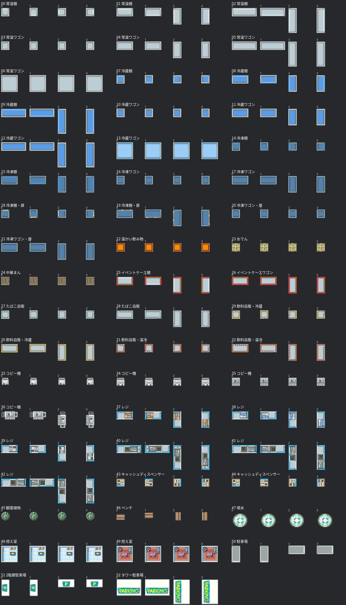
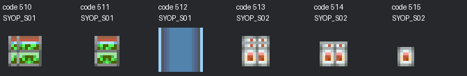

# 店内什器・商品画像を原TIMの切出しへ接続

2026-11-17 JST。［確実］什器53種×4方向の212表示と、既存の商品補充表で参照する在庫画像を、元画像3枚の画素・パレットへ接続した。**什器・商品・在庫の選択規則自体は既知である。今回は表示番号と実画素の対応表を追加した。** 原CPUによる営業・検証は実行していない。

## 今回追加した対応

| 対象 | 結果 |
|---|---|
| 53什器・4方向 | 212表示。元の論理部品97種を使い、247個の異なる表示番号を参照 |
| 通常の商品画像選択 | 既存688補充プラン・2,016月別バリエーションを再利用。画像基準88種×残量3段階＝264表示番号 |
| 上記の合計 | 511表示番号を元画像へ接続。切出し不足0 |
| 宣言表だけにある商品画像 | コピー用紙の基準624、現金の基準627。残量段階を含む6表示番号を別区分で接続 |
| 保存した切出し表 | 計517表示番号。元画像ID・矩形・パレットと、画素番号列/原色ワード列のSHA256 |

「通常」は既存の方向・月別補充表に出現するという意味である。自然プレイで全て出現したという観測ではない。数量0では商品画像を表示しないため、残量段階2の画像が必ず画面に出るとも解釈しない。

## 原画像との接続

表示番号は原0x8005670Cの比較表を使い、以下の通りに元画像を選ぶ。**256・512は前のページに残る。** 単純な整数除算でページを切り替えない。

| 表示番号の条件 | 原描画種別 | 元ファイル | 元画像の寸法 |
|---|---:|---|---|
| code ≤ 256 | 9 | SYOP_S00.TIM | 256×256 |
| 256 < code ≤ 512 | 11 | SYOP_S01.TIM | 256×256 |
| 512 < code ≤ 768 | 13 | SYOP_S02.TIM | 256×128 |

上表は原描画処理の比較規則であり、768までの全番号に有効な画素があるという意味ではない。今回照合した517番号のみ、元画素ペイロード内に収まることを確認した。表中の9・11・13は描画レコードの種別値であり、原GPUのTPAGEワードやファイルIDとは区別する。

切出し位置は`X=(code&15)×16、Y=code&240`、サイズ16×16。TIMに保存された8bitパレット番号256個と、その各番号が参照する元BGR555/STPワード512バイトのハッシュを別々に保存した。元TIMの全体・画素・パレットのハッシュも持つ。

- [全517番号の元画像対応](image-source-crops.json)。
- [原画像と原命令の出典](source-provenance.json)。原TIMは既存r2アーカイブを参照し、重複保存していない。

PNGは原色ワード0を透明、他を通常表示とした参照用である。STPを使うGPUの半透明合成・照明・重なりを再現したゲーム画面ではない。

## 什器の向きと部品配置

原EXEの0x8009C7A0には101行×4方向の論理部品画像表がある。既知の起動処理0x8005C858は各値に60を一度だけ加える。今回、53什器の有効な部品矩形から97行が参照され、247個の表示番号へつながった。

方向0・1は元の部品配置、方向2・3は配置軸を交換し、それぞれの方向専用画像を選ぶ。部品自体をスマホ側の汎用回転で回す規則ではない。既知の原0x800799ACの生成規則を再利用し、16画素単位の配置位置と元画像の切出し位置を結んだ。

[全212表示の部品一覧](fixture-direction-crops.json)。各表示に元の方向番号0～3を記録し、根拠なく東西南北へ命名していない。什器ラベルは既存MSG00復号結果を使用した。



この一覧は什器本体だけを示し、在庫商品や人物を重ねた完成画面ではない。たとえば「温かい飲み物」の販売機・コピー機・レジ・控え室・駐車場も、画像表が参照する原部品として掲載している。

## 商品画像と512番の境界

既存688補充プランの参照先を商品27件にまとめ、通常で使う基準88種を接続した。方向・月別のプランを重複して作り直したり、2,016バリエーションを新規発見と数えたりしていない。[商品別の参照範囲](product-source-usage.json)から既存プランへ辿れる。

冷凍食品類（商品17）は基準507・510・513を参照する。基準510の残量段階2は表示番号512となる。原比較に従うと、512は**SYOP_S01.TIMの(0,0)**、次の513は**SYOP_S02.TIMの(16,0)**である。



画像512が他の冷凍食品と違う見た目でも、元コードの対応を勝手に513や別ページへ補正しない。上限を含む比較と商品17の画像基準は以前から判明しており、今回の追加は実際の元画素・パレット・ハッシュと結んだことにある。新たに原作の不具合を発見した、実機画面で観測した、という意味ではない。[境界の原素材参照](page-boundary-source.json)に保存した。

コピー用紙と現金の画像枠11には、通常プランに出ない基準624・627がある。どちらも3段階の絵を元画像内から取得できるが、その存在だけで専用の印刷・引出し・収益仕様を追加しない。これら6表示番号は「宣言表のみ」に分離し、使用場面の未確定を維持する。

## 最小限の照合と再抽出

```sh
python extract-interior-crops.py /path/to/restored-source.zip
```

Python、Pillow、Capstoneを使用。原アーカイブ・EXE・元画像のSHA256、既存の什器/商品マスターとの一致、参照する番号と矩形の範囲を一回の静的抽出で確認した。原CPU呼出し0回、営業更新0回であり、大量の状態遷移試験は追加していない。

一次資料はユーザー提供ディスクの原EXEとSYOP_S00/01/02.TIM。EXEのSHA256は`d6a167a1c9e0fe98d7e44e12968caa489ac3eb7ed3b9e46012a188af8432b1fd`。[抽出コード](extract-interior-crops.py)、[原命令抜粋](interior-image-readers.asm)、最小限の原表・原命令バイト、[要約](summary.json)、ファイルハッシュを保存した。

既知のルールはr2の`interior_display.py`、`preview_producer.py`、前回までの[商品・什器データ](../20261113-product-stock-data/README.md)と[画像転送対応](../20261117-texture-runtime-binding-data/README.md)を参照した。

## Androidへの引継ぎ範囲

[移植用の対応仕様](android-interior-crops-bridge.json)に元画像ID・切出し表・方向部品表と注意点をまとめた。商品画像は各マスの保存済み番号から描画する。月変更のたびに現在月から絵柄を作り直すことはしない。この保存規則も既存解析を引き継いだもので、今回新たなAndroid処理を実装したわけではない。

店内の床・壁・人物・経路・UI・最終合成まで全部の素材参照を網羅したという結論にはしない。Android本体とAPKは未変更。台帳の7残件は解明1・未解決6を維持する。
