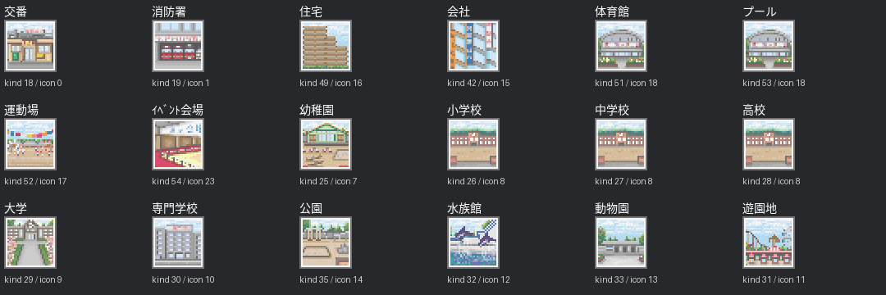

# 通知の画像種別・予約箇所と誘致完成アイコンの接続

2026-11-17 JST。［確実］**店舗アイコンと建物アイコンは転送先・CLUTを共有するため、UV座標だけで素材を選べない。** 原通知の画像分岐8種類、予約の直接呼出し34箇所、誘致18施設の完成アイコンを接続した。原CPU実行・営業更新は0回。

## 今回追加した対応

| 対象 | 結果 |
|---|---|
| 通知画像の分岐表 | 画像種別1～8の8分岐と、画像なしの種別0を原命令へ接続 |
| 通知予約への直接JAL | 34箇所。各直前の基本ブロックだけで画像種別・表示モードが定数に確定 |
| 建物通知画像 | BUILDIN1.TIMの32×32・32枠を原画素へ接続。全枠に非透明画素あり |
| 誘致完成通知 | 18施設から15種類の画像を参照。全18対応で原画素不足0 |
| 既存成果の再利用 | 通知キューの基本処理、モード、画像ヘルパー、誘致マスターと名称は既知 |

今回の34箇所は「イベント34種類」や「34回の実プレイ観測」を意味しない。同じ処理に複数の通知予約がある。間接呼出し・実行時の到達性・通知頻度を網羅した結果でもない。

## 画像種別と表示モードを分ける

原予約0x8003ECD8の引数は`画像種別、画像パラメータ、音要求、表示モード、追加値`。最後の追加値はスタックの第5引数である。原キューは160バイト刻みで、本文用に120バイトを複写する。

画像種別は原0x8003FF00の分岐を選ぶ。表示モードはキュー+2を別に読み、文面・月次報告・年次報告を選ぶ。**同じ番号だから同じ役割という扱いにはしない。**

| 画像種別 | 原分岐 | 素材・処理 |
|---:|---|---|
| 0 | 画像スイッチに入らない | 画像なし |
| 1 | 0x8004000C | SHOPTYP1、0x80067494の店舗アイコン枠 |
| 2 | 0x8004015C | BUILDIN1、0x8006B620の建物アイコン |
| 3 | 0x8004028C | 0x800675DCの顔画像・未選択枠 |
| 4 | 0x800402E0 | PS_CM1をロードし、0x8006A304へ渡す |
| 5 | 0x8004041C | PS_CM1と原テンプレート0x80010998 |
| 6 | 0x8004057C | PS_CM1と原テンプレート0x80010974 |
| 7 | 0x800406DC | 表示タイマーを0へ。画像分岐なし |
| 8 | 0x800406EC | 表示タイマーを0へ。画像分岐なし |

5・6は原テンプレートと呼出し位置を保存した範囲で、描画矩形を今回新たに解釈・確定していない。7・8のタイマー0を、活動フラグの即時解除と読み替えない。

| 表示モード | 文面・報告の経路 |
|---:|---|
| 1 | 本文領域0x800E3AA0を表示。画像種別7未満では予約本文を複写。Xは画像種別0で+32、3で+72、その他で+56、Yは+16 |
| 2 | 月次報告0x8006C048を(0,64)で表示 |
| 3 | 年次報告0x8006C8B0を(16,48)で表示 |

文面は画像種別ごとに一つの固定メッセージへ決まるのではない。通常モード1・画像種別7未満では、予約前の各処理が組み立てた本文を使う。画像種別7以上は原取り出し処理が本文コピーを飛ばすため、同じ説明を一律に適用しない。全文面の復号や全可変項目の展開を今回行ったとは扱わない。[分岐と表示経路](notification-image-routes.json)へ原アドレスを保存した。

## 34予約箇所の静的な引数

[直接呼出し一覧](notification-reservation-sites.json)は0x80011C00～0x80097FFFのJAL0x8003ECD8を抽出したもの。呼出し直前の制御移動をまたがない範囲で即値・レジスター複写・単純算術を追う。メモリ読込み、直前関数の戻り値、先行分岐から来る値は推定せずnullのまま保存した。MIPSの遅延スロットも対象に含む。

| 原画像種別 | 直接予約箇所数 |
|---:|---:|
| 0 | 13 |
| 2 | 4 |
| 3 | 14 |
| 4 | 3 |

表示モードは1が32箇所、2と3が各1箇所。1・5～8などがこの直接呼出し一覧に現れないことを、ゲーム全体で未使用だという証明にはしない。引数には静的に分かるものと実行時に決まるものが混在するため、音要求や画像パラメータのnullを0で補わない。

## 誘致18施設から15画像へ

原0x80029284～0x800292A4は建物マスター56バイト刻みの+52を読み、0x800292DC～0x800292ECで画像種別2とともに予約へ渡す。**これは建物種別でも誘致選択番号でもなく、通知画像番号である。**

| 施設 | 建物種別 | 通知画像番号 |
|---|---:|---:|
| 交番 | 18 | 0 |
| 消防署 | 19 | 1 |
| 住宅 | 49 | 16 |
| 会社 | 42 | 15 |
| 体育館 | 51 | 18 |
| プール | 53 | 18 |
| 運動場 | 52 | 17 |
| イベント会場 | 54 | 23 |
| 幼稚園 | 25 | 7 |
| 小学校 | 26 | 8 |
| 中学校 | 27 | 8 |
| 高校 | 28 | 8 |
| 大学 | 29 | 9 |
| 専門学校 | 30 | 10 |
| 公園 | 35 | 14 |
| 水族館 | 32 | 12 |
| 動物園 | 33 | 13 |
| 遊園地 | 31 | 11 |

小中高校は画像8、体育館とプールは画像18を共有する。施設名が違うからといって別の通知画像を作り足さない。この共有番号自体は既存誘致マスターに抽出済みだった。今回の追加は原BUILDIN1の実画素へ接続した点である。



[18施設の対応](project-notification-image-links.json)には、既存の施設名メッセージ番号も保持した。ただし、それは完成通知本文全体を表す番号ではない。[全32アイコンの切出し](building-notification-crops.json)にインデックス・原色ワード・パレットのハッシュを保存した。32枠すべての通常使用を示す一覧ではなく、今回の18施設が使うのはその15枠である。

## 同じVRAM位置の別画像を区別する

SHOPTYP1とBUILDIN1は双方、画素転送先の左上が16bit語単位(832,128)、CLUTが(0,490)。前者は元高さ32、後者は128で、先頭の32画素アイコン列のUVは重なる。

通知の画像種別1は画像ID6・SHOPTYP1を選び、種別2は画像ID17・BUILDIN1を選ぶ。このロード選択を含めず、種別13という描画レコードやUVだけで素材を引くと取り違える。Androidでは元ファイルIDと切出し矩形を直接持つ。

BUILDIN1の画像番号i（今回0～31）では、原0x8006B620はU=`(i%8)×32`、V=`((i/8)×32−128)&255`。転送先のY128を差し引くと、元画像では`((i%8)×32,(i/8)×32,32,32)`となる。全32枠が256×128の原画素内に収まった。

## 再抽出と残す範囲

```sh
python extract-notifications.py /path/to/restored-source.zip
```

Python、Pillow、Capstoneを使用。原アーカイブ・EXE・TIMのSHA256、原分岐表、直前ブロックの引数、建物マスター+52と既存抽出値、元画素の範囲を静的に照合した。原CPU実行・営業シミュレーションは追加していない。

一次資料はユーザー提供ディスクから保存された原EXEとBUILDIN1.TIM。原EXEのSHA256は`d6a167a1c9e0fe98d7e44e12968caa489ac3eb7ed3b9e46012a188af8432b1fd`。

[抽出コード](extract-notifications.py)、[原資料ハッシュと最小範囲](source-provenance.json)、[原命令抜粋](notification-readers.asm)、[要約](summary.json)と、34箇所の原命令窓・分岐表・未解釈テンプレートを保存した。大きい原画像は既存アーカイブを参照し、重複保存していない。

[Androidへの接続仕様](android-notification-bridge.json)は画像種別・画像パラメータ・表示モード・音要求・本文を分ける。今回アプリ本体とAPKは未変更。全通知本文・全動的引数・自然発生頻度・5/6の原テンプレート描画までは未確定である。誘致完成音の残件R05も、このアイコン対応によって解決したとは扱わない。7項目の台帳は解明1・未解決6を維持する。
