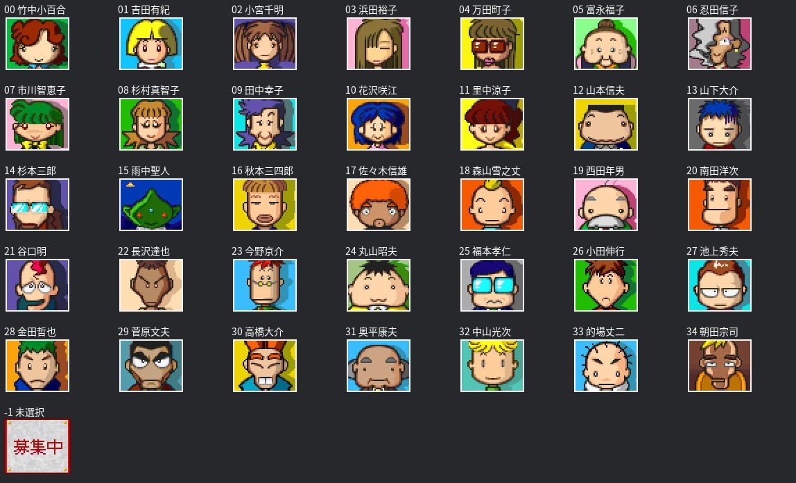

# 店員35人の顔画像と未選択枠を原画素へ接続

2026-11-17 JST。［確実］4マップ・140件の原店員レコードの顔番号を、35人分の原画像へ接続した。未選択時の「募集中」枠もKYOU.TIMの別画像へ接続した。**顔描画の算式や35人のプロフィール自体は既知であり、今回の追加は人物名・原レコード・実画素の対応付けである。** 原CPU実行・営業更新は0回。

## 追加した対応

| 対象 | 結果 |
|---|---|
| 顔番号0～29 | KAO01.TIMの5列×6行。48×40画素、30人分 |
| 顔番号30～34 | KAO02.TIMの5列×1行。48×40画素、5人分 |
| 未選択番号−1 | KYOU.TIMの(48,136)から48×40。「募集中」の枠 |
| 原店員レコード | TOWN0001/0002/0003/PSの各35件、計140件と顔番号を照合 |
| パレット | KAO01とKAO02の512バイトは同一。原CLUT転送先も双方(0,494) |
| 原画素の欠落 | 対象36矩形は全て元ファイル内に収まる |

[元画像の全切出し](portrait-source-crops.json)に元画像ID・矩形・描画レコード種別・CLUT行と、1,920画素番号/3,840バイト原色ワード列のSHA256を保持した。元TIM全体とパレットのハッシュも別に記録している。

## 顔番号と体画像を分ける

原TOWNの24017バイト後から、店員54バイト×35件を読む。原保存レコードの+7にある顔番号は、原ローダーによって実行時レコード+8へ入る。体画像は保存+5→実行時+6であり、顔とは別のフィールドである。

原0x800700E4および0x80070470は、60バイト刻みの店員レコードから実行時+8の顔番号を読み、0x800675DCへ渡す。0x80070148は空き枠に−1を指定する。配属後に体画像が役割・性別によって変わる規則は既存解析の通りで、顔番号をその体画像へ置き換える根拠にはならない。

[4マップ・140件の対応](town-staff-portrait-links.json)に人物名、名前番号、顔番号、元の体画像番号、保存位置と54バイト原レコードのハッシュを記録した。人物名は[既存の店員解析](../20261114-staff-roster-growth-data/README.md)のMSG00/PSMOJI復号結果を再利用した。新たなフォントOCRや人物名の発見ではない。



このPNGは原画像を切り出して名前を添えた資料である。原UI全体やAndroidの実装画面ではない。原色ワード0を透明とした参照表示であり、GPUの半透明合成・UI枠・点滅・画面遷移の再現までは含まない。

## 原描画規則と実ファイルの範囲

原0x800675DCは顔番号を符号付き16bitとして扱う。通常の非負番号では5で割った余りが列、商が行となる。

```text
列 = 顔番号 % 5
行 = 顔番号 / 5
U = 列 × 48
行 < 6なら KAO01、V = 行 × 40、描画種別21
行 >= 6なら KAO02、V = (行−6) × 40、描画種別23
```

−1はこの通常表とは別分岐で、KYOUのU48・V136、描画種別7、CLUT行492を使う。顔のCLUT行494を流用しない。

KAO01は256×256で、通常の30顔は行0～239を使う。KAO02は256×40で、通常の5顔は行0～39だけを使う。どちらも顔の列はX0～239で、右側16列はこの35人の顔切出しには使わない。この幾何学的な未参照範囲を、画像全体の未使用領域と断定しない。

前回までにKAO02の転送要求が64行、元画素が40行であることは判明済みだった。**今回の対応から、35人の通常顔表示には存在しない40～63行を補う必要がない**と分かる。転送先だけを見て64行の顔シートを生成しない。

また、数式へ35を入れるとKAO02の(0,40,48,40)となり、元40行を超える。初期店員に35の参照はない。以前のr2には番号0～59を制御入力として描画ラッパーへ渡す検証があったが、60人分の顔素材や通常参照を証明したものではない。今回その検証を繰り返していない。[原画素境界の整理](portrait-source-boundary.json)を参照。

## 原コードと既知事項の区別

[原UI参照一覧](portrait-ui-source-links.json)には0x800675DCへの直接呼出し6か所を記録した。全ての間接参照や自然操作の到達性まで証明した一覧ではない。

顔の5列配置・6行切替・−1の分岐・色引数は、既存r2の`icon_layout.py`と原ラッパー検証で判明していた。店員35人と4マップの保存構造も既知である。今回新しく接続したのは、これらの参照から実TIMの画素・パレット・有効行へ至る対応と、初期140件の使用範囲である。

## 再抽出と引継ぎ

```sh
python extract-portraits.py /path/to/restored-source.zip
```

Python、Pillow、Capstoneを使用。入力アーカイブ・EXE・TIMのSHA256、既存名簿と原54バイトの顔/名前フィールド、切出し範囲、共通パレットを静的に照合した。原CPUの再実行や営業シミュレーションを追加していない。

一次資料はユーザー提供ディスクから保存された原EXE、4つのTOWNファイル、KAO01/02.TIM、KYOU.TIM。原EXEのSHA256は`d6a167a1c9e0fe98d7e44e12968caa489ac3eb7ed3b9e46012a188af8432b1fd`。

[抽出コード](extract-portraits.py)、[原資料ハッシュと命令範囲](source-provenance.json)、[原命令抜粋](portrait-readers.asm)、[結果要約](summary.json)を保存した。原画像・全TOWNは既存アーカイブにあるため重複保存していない。

[Android用の参照仕様](android-portrait-bridge.json)では、顔番号0～34、未選択−1、体画像番号を分けた。元画像IDと切出し矩形を使い、VRAMの同じ転送先を使うタイトル画像と混同しない。原EXE・BIOS・PSエミュレータへの実行時依存は不要である。

アプリ本体とAPKは今回未変更。7項目の残件台帳は解明1・未解決6を維持する。この顔素材の対応だけで全人物UIや全画像経路の解析が完了したとは扱わない。
