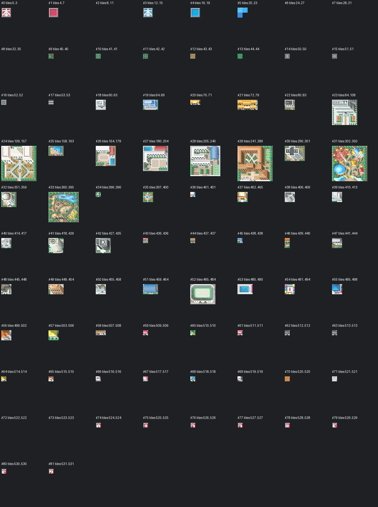
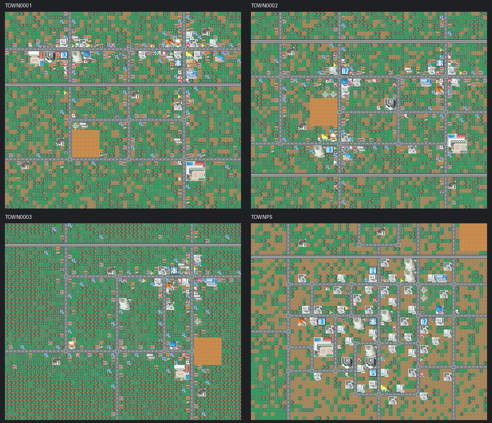

# 街CEL・建物・初期4マップを元画像の切出しへ接続

2026-11-17 JST。［確実］街タイル640枚を、原TIMの画素・パレットと、建物マスター82行・初期4マップの画像番号へ接続した。**建物82種類の新発見ではない。既存のCEL構造・建物定義・店舗番号変換を再利用した、描画素材と使用データの対応付けである。** 原CPU実行と営業更新は0回。

## 今回追加したもの

| 対象 | 接続結果 |
|---|---|
| 原CELの宣言640枠 | 全枠のUV・CLUT・TPAGEから、TOWN_PR1.TIMの8×8画素へ対応付けた。全て元画素の範囲内 |
| 建物マスター82行 | 元の寸法・タイル範囲から、各部品の切出し位置と配置位置をJSON化 |
| 店舗番号画像 | 既知の十位・一位変換8系統×10数字、計80切出しが元画像内に収まる |
| 初期4マップ | 60×50×4＝12,000セルを元画像へ接続。店舗番号画像への差替えは計28セル。未解決参照0 |
| 元画素との対応 | 各タイルの64インデックスと128バイトの原色ワード列のSHA256を記録 |

CELの640宣言枠・800物理枠・160枠のゼロ末尾は、旧r2の`cel-source-tables.json`で既知である。建物72行、後ろ69行の別の既存出力、原0x80019870の番号変換、町描画処理の過去の原命令検証も再利用した。今回これらの解析や検証をやり直した成果として数えない。

追加したのは、**画像ロード先だけでなく、全街タイルの実際の画素範囲と、そのタイルを使う建物・初期マップを一続きに参照できるデータ**である。画像・建物名や町を新たに発見したという意味ではない。

## 元画像への座標変換

原CELは8バイトのヘッダーの後、8バイト刻みの`u8 U / u8 V / u16 CLUT / u16未使用 / u16 TPAGE`を置く。先頭640枠は8bitインデックスのページ0x97、CLUT0x7900を参照する。

原転送先は画素が16bit語単位で`(448,352,128,160)`、パレットが`(0,484,256,1)`。TIM内の画素は256×160であり、元ファイル内の座標を直接採用しない。

```text
VRAM画素X = (TPAGE & 15) × 64 × 2 + U
VRAM行Y   = ((TPAGE >> 4) & 1) × 256 + V
元画像X   = VRAM画素X - 448 × 2
元画像Y   = VRAM行Y - 352
```

このファイルではTPAGE0x97のため、元画像X=U、元画像Y=V−96となる。タイル0は元(0,0)、639は元(248,152)から8×8を切り出す。全640枠が256×160の画素ペイロードに収まり、余分な画像行を補う必要はない。

原CLUT値は`X=(CLUT&63)×16、Y=CLUT>>6`で(0,484)へ一致した。各タイルについて、64個のパレット番号だけでなく、その番号を引いた元BGR555/STPワード128バイトのハッシュも保持する。PNGは0ワードを透明として参考表示し、半透明ブレンドやGPUの最終出力を再現したものではない。

[全640枠の対応表](cel-to-source.json)、[元画像プレビュー](town-source-preview.png)。原TIMは既存アーカイブ中の`algorithm-analysis/source/TOWN_PR1.TIM`を参照し、重複保存しない。

## 建物表の番号を取り違えない

原0x8009D738から56バイト×82行を読む。内訳は店舗定義9行、前半の空き地4行、環境・施設など59行、拡張名10行である。未使用という名称の店舗定義や、繰返し名称、道路等も含む。固有の建物82種類を意味しない。

既存`customer-data.json`の69行は、その13行後の0x8009DA10から始まる。例えば同ファイルの交番ID5は、今回の原マスター全体では行18となる。同じID空間として連結してはいけない。元画像のタイル番号60～63はどちらでも同じである。

全82行で`幅×高さ=終端タイル−先頭タイル+1`を確認し、部品を行優先で並べた。マスターのタイル範囲にない番号にも名前を勝手に割り当てない。特に拡張02～09のタイル524～531は店舗番号の描画用テーブルにも含まれるので、番号だけで拡張施設の完成画像とみなさない。

[建物ごとの切出し位置](building-source-crops.json)。[建物部品の一覧](building-crops-preview.png)では各枠の先頭に原マスター番号とタイル範囲を表示している。



## 初期4マップの接続

原TOWNの17バイト後から、60×50セル、1セル8バイトの先頭符号付き16bit値をタイル番号として読む。格納された10店舗レコードを読み、既知の原0x80019870の規則に従って特殊タイル4～7・16～19を表示用番号へ置き換える。

| マップ | 稼働店舗 | 店舗番号画像へ差替えたセル | 元画素への未解決参照 |
|---|---:|---:|---:|
| TOWN0001 | 2 | 4 | 0 |
| TOWN0002 | 3 | 8 | 0 |
| TOWN0003 | 1 | 0 | 0 |
| TOWNPS | 5 | 16 | 0 |

番号変換は、対象セルを含む最初の稼働店舗の`+4の下位7bit`を十位または一位へ分け、524～533の表と系統オフセットを使う。元タイル12～15などはそのまま表示するため、店舗数と差替えセル数は単純に比例しない。初期4マップの対象セルには全て該当店舗があった。原コードに残る「店舗が見つからないとスタック残値を参照する」経路について、新しい挙動は仮定していない。

各差替えの位置・原タイル・表示画像番号・店舗スロット・識別値は[four-town-source-map.json](four-town-source-map.json)へ記録した。全12,000画像番号は[圧縮u16配列](resolved-town-images.u16.zlib)で保存し、伸長後24,000バイトのSHA256も記録している。



これは原データの参照画像である。実際のゲーム画面のスクリーンショットではない。画面上の拡大率、スクロール、時間帯の色、UI、選択枠、店名・数字の別レイヤー、半透明の最終合成は対象外。4マップの営業を再実行した成果でもない。

## 再抽出・保存物

```sh
python extract-town-tiles.py /path/to/restored-source.zip
```

Python 3.12、Pillow、Capstoneを使用。Unicornは不要。原アーカイブとEXEのハッシュ、既存72行/69行との重なり、原TIMのハッシュ、全切出し範囲と初期マップの参照範囲を一度の静的抽出で照合する。原CPUによる営業検証や大量の入力試験は追加していない。

一次資料はユーザー提供ディスクから保存された原EXE、TOWN_PR1.CEL/TIM、TOWN0001/0002/0003/PS。原EXEのSHA256は`d6a167a1c9e0fe98d7e44e12968caa489ac3eb7ed3b9e46012a188af8432b1fd`。[原資料のハッシュと最小範囲](source-provenance.json)、[原命令抜粋](town-image-reader.asm)、[再抽出コード](extract-town-tiles.py)、[要約](summary.json)を保存した。

Androidでは[切出し・番号空間の仕様](android-town-tile-bridge.json)を使い、元画像IDと切出し矩形を参照する。原EXE、GPUのVRAM配置、原CPU実行に実行時依存させない。この成果は素材と仕様の追加であり、Android本体とAPKは変更していない。管理中の7残件は解明1・未解決6を維持する。
