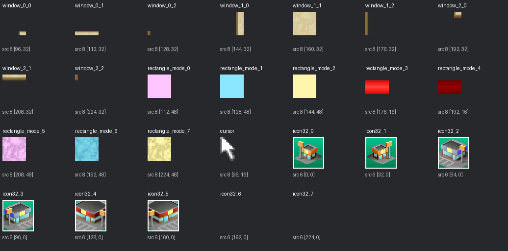
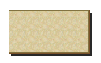

# UI枠・矩形スタイル・カーソル・32画素アイコンの原画素対応

2026-11-17 JST。［確実］ウィンドウ枠9部品、矩形スタイル8部品、選択カーソル1領域、32×32アイコン8枠、計26領域を原画像へ接続した。**アイコン8枠のうち6・7番は全画素が透明であり、8種類の有内容画像があるという意味ではない。** 原CPU実行・営業更新は0回。

## 今回追加した対応

| 対象 | 元画像 | 結果 |
|---|---|---|
| ウィンドウの9部品 | KYOU.TIM | 16×16の原部品と上下左右・中央の位置を接続 |
| 矩形の8スタイル | KYOU.TIM | 原0x80010078のUV表8件を画素・パレットへ接続 |
| 選択カーソル | KYOU.TIM | (96,16)から16×16の原画像へ接続 |
| 32×32アイコン | SHOPTYP1.TIM | 8枠を行0～31へ接続。0～5に画像、6・7は全透明 |
| 原画素の不足 | — | 今回の26矩形では0件 |

[全領域の対応表](ui-source-crops.json)に原画像ID・描画種別・UV・元画像の切出し位置・CLUT位置と、画素番号列/原色ワード列のSHA256を保存した。全透明かどうかは、各画素の参照先パレットワードが全て0かで判定した。見た目だけから空白と推測したものではない。

ウィンドウ分割、矩形UV表、カーソルUV、アイコンの`code&7`は、r2の`window_tiles.py`、`settings_rectangles.py`、`confirmation_dialog.py`、`icon_layout.py`などで既知である。今回それらを原TIMの有効画素へ結び直した。これらの基本処理を新たに解読した、以前の大量の原CPU検証を今回行った、という意味ではない。



PNGは原色ワード0を透明とし、他の色を表示した参照画像である。STPによるGPU半透明混合・点滅・原UIの重なりを再現した画面ではない。部品の透明な余白も元16×16または32×32のまま保持している。

## ウィンドウ枠は画素の引伸ばしではなく16画素単位の配置

原0x80017B18/0x80017C3C/0x80017FD4の既知の規則では、幅・高さは16画素セル数。両方2以上が必要である。上・中・下の行と、左・中・右の列から、次の部品を選ぶ。

| 行 | 左U | 中U | 右U | V |
|---|---:|---:|---:|---:|
| 上 | 96 | 112 | 128 | 32 |
| 中 | 144 | 160 | 176 | 32 |
| 下 | 192 | 208 | 224 | 32 |

元画像はKYOU、描画レコード種別7、CLUTは(0,492)。画面座標の原点補正`x−160、y−112`と元画像の切出し座標を混同しない。

[配置仕様と8×5セルの参照例](window-source-composition.json)を保存した。下は128×80の部品合成例であり、原ゲームの特定画面を実行した結果ではない。



## 矩形スタイルとカーソル

矩形スタイルの原表0x80010078は、次の8組のUVを持つ。番号に独自の用途名を割り当てず、原モード番号を保持する。

| モード | U | V |
|---:|---:|---:|
| 0 | 112 | 48 |
| 1 | 128 | 48 |
| 2 | 144 | 48 |
| 3 | 176 | 16 |
| 4 | 192 | 16 |
| 5 | 208 | 48 |
| 6 | 192 | 48 |
| 7 | 224 | 48 |

これらは上の9部品ウィンドウとは別の番号空間である。原0x800182D0が幅を16画素単位や端数へ分割し、0x800185A4が各矩形レコードを作る。今回の一覧は各スタイルの全16×16標本であり、任意幅へ画像を伸縮する仕様ではない。

原0x8004E938のカーソルはKYOUの(96,16,16,16)。既存の確認ダイアログ・設定画面・街/店内カーソルのモデルが同じUVを使う。どの呼出し経路でも同じ位置・同じ時間で表示されるという意味ではない。

## 描画種別だけでは素材を一意に決められない

原0x80067494は32×32アイコンを描き、U=`(code&7)×32`、V=128、描画種別13、CLUT行490を使う。通知側では0x80040020で画像6の転送矩形を選び、0x800400F4で転送し、0x8004014Cでこのラッパーを呼ぶ。

SHOPTYP1の転送先は16bit語単位で(832,128,128,64)。描画種別13のページ基点はX=832語・Y=0であるため、UVのV128は**元SHOPTYP1のY0**となる。原画像は256×32で、8枠の切出し矩形は`(32×枠番号,0,32,32)`である。

前回の店内画像表では、同じ描画種別13のUV0～112はSYOP_S02内の商品画像を参照していた。**種別13を常にSYOP_S02へ固定すると、このアイコンを取り違える。** 原画像ID・ロード範囲・UV・CLUTを組として扱う必要がある。

SHOPTYP1の元高さ32・転送要求高さ64の差は既知である。今回の8枠は全て実在する行0～31に収まり、不足行32～63を補う必要がない。6・7番を透明なまま記録し、追加の店舗種類・操作モード・画像を創作しない。[有効行の対応](source-height-boundaries.json)に保存した。

## 再抽出と検証範囲

```sh
python extract-ui-crops.py /path/to/restored-source.zip
```

Python、Pillow、Capstoneを使用。原アーカイブ・EXE・TIMのSHA256、原UV表と既知値の一致、26切出し範囲、透明パレットの参照を静的に照合した。原CPUの営業・入力・大量の状態遷移検証は追加していない。

一次資料はユーザー提供ディスクから保存した原EXE、KYOU.TIM、SHOPTYP1.TIM。EXEのSHA256は`d6a167a1c9e0fe98d7e44e12968caa489ac3eb7ed3b9e46012a188af8432b1fd`。

[抽出コード](extract-ui-crops.py)、[原資料ハッシュ・最小原命令範囲](source-provenance.json)、[原命令抜粋](ui-image-readers.asm)、[要約](summary.json)を保存した。元TIMは既存アーカイブを参照し、重複保存していない。

[Androidへの接続仕様](android-ui-frame-bridge.json)では、9部品枠・8矩形スタイル・カーソル・8アイコン枠を分離した。原EXE・BIOS・PSエミュレータへの実行時依存は不要。今回アプリ本体とAPKは未変更である。

文字フォント、全ボタン・全記号、全通知の使用場面、画面全体の描画・合成を網羅した結果ではない。7項目の残件台帳は解明1・未解決6を維持する。
